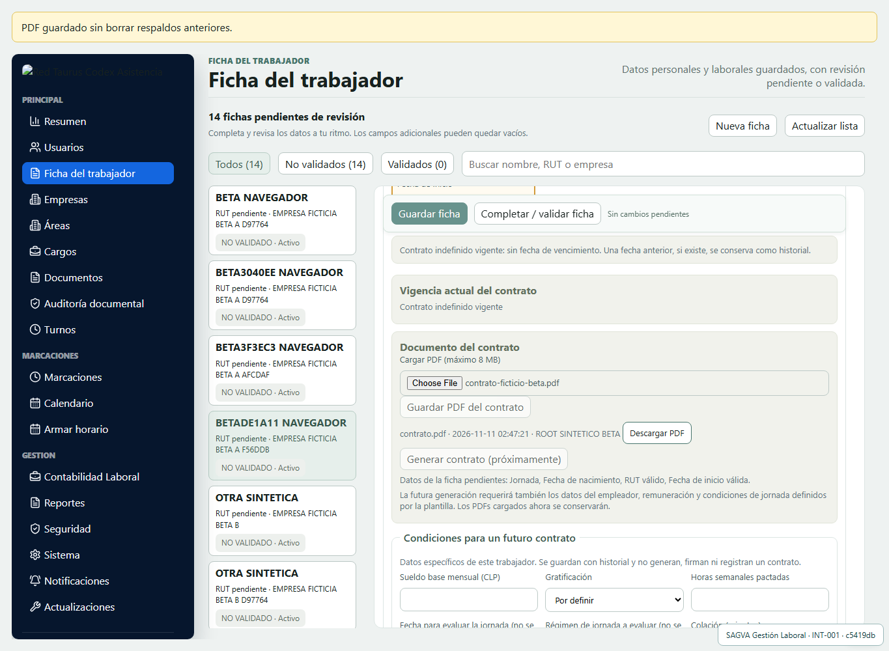
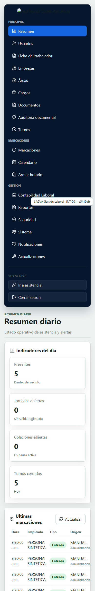

# Informe beta aislada P2/P3/DT — Windows, 11-11-2026

**Recomendación: mantener en beta; NO integrar todavía a main.** Las pruebas técnicas pasan, pero faltan flujos operativos y controles de seguridad/DT. No se fusionó ningún PR, no se sustituyó el sistema principal y no se declara conformidad DT.

## Versión exacta y aislamiento

- Repositorio SAGVA Gestión Laboral; rama `feat/dt-integracion-validacion-20261111`.
- Partida: `a916cf5cbdd6b23d9532ed0d043f53aca056352a`.
- **Último commit de código ejecutado y validado: `c5419dbba02f351663d50efa1b02ea97993b9f29`.** Los commits posteriores de este informe sólo agregan documentación/evidencias.
- Versión heredada package.json `1.19.2`, etiqueta INT-001; ensayo beta, no versión productiva certificada.
- Instalación Windows independiente: `sagva-laboral-beta-dt-20261111`. API 4022 y web **http://127.0.0.1:5195**, ambas en loopback; un único proceso beta identificado por ruta/PID/fecha. Principal conserva 4010/5183 y sus procesos, commit y configuración privada sin cambios.
- No se ejecutó Actualizar.bat ni se copió SQLite, documentos, Root o secretos del principal. Base creada mediante **node tools/crear-base-ensayo-dt.mjs**, destino nuevo aleatorio dentro de .local, con marcador de ensayo. Resultado inicial: 0 trabajadores, 0 relaciones, 0 previsiones y 0 marcaciones, integridad ok y FK 0. Todas las migraciones de esta rama se aplicaron desde cero.
- Root, JWT y clave bancaria exclusivamente sintéticos e independientes. Credenciales locales en `.local/beta-access.txt`, fuera de Git. No se crean ni importan personas reales.

## Resultados finales sobre el código validado

| Grupo | Aprobadas | Fallidas |
|---|---:|---:|
| Suite automática del servidor | 100 | 0 |
| Escenarios API por web → proxy real → Express → SQLite beta | 12 | 0 |
| Escenarios persistentes P2/P3, integridad y restauración beta | 5 | 0 |
| Escenarios Chromium de interfaz Windows/móvil emulado | 7 | 0 |

Las cifras corresponden a pruebas o escenarios de cada grupo, no a cantidad de requisitos legales acreditados. Además: sintaxis/manifiestos correctos, build Vite aprobado y npm audit **0 vulnerabilidades**. Configurador ensayado sobre otra base vacía: crea sólo Root sintético y rechaza repetición sin rotar secretos.

Se repitió la suite y compilación tras la última corrección; se reinició únicamente la beta y se repitieron API, almacenamiento y navegador. Un primer intento API inmediatamente tras iniciar corrió antes de la disponibilidad HTTP y falló por conexión; se confirmó health antes del ensayo final, que pasó. No se atribuyen a este SHA resultados de PR anteriores.

## Funcionamiento comprobado y límites por módulo

| Dominio | Evidencia ejecutada | Límite / pendiente |
|---|---|---|
| Trabajadores/fichas | Alta y edición en API y UI; revisión antigua rechazada; guardados simultáneos devuelven 200/409 | Sin conciliación nominal ni normalización de personas reales |
| Empresas/áreas/cargos | Altas por API, asignación desde ficha/UI y conservación de company_id en edición | No hay flujo UI/API completo de sucursales históricas P2 |
| P2 contratación y recontratación | SQL beta: empleo terminado y nuevo empleo, asignaciones, fechas, sueldo por vigencia, rechazo de solapamiento/sucursal ajena/vínculo incorrecto de marca | **Modelo estructural probado, NO flujo UI/API integral de alta/término/recontratación** |
| P3 autoridad/previsión | Proyección y vigencias probadas; AFP/Isapre históricas y plan UF; extra_json conservado | No hay backfill ni cambio general de consumidores; normalización completa pendiente |
| AFP/Fonasa/Isapre actuales | Catálogos API y guardado desde UI con cambios de sistema de salud | No equivale a validar previsión legal individual ni trasladar datos reales |
| Jornadas/turnos | Crear grupo/horario, asignar turno/calendario, evaluar límites por fecha/régimen | Regímenes especiales/exentos informan no evaluado; no dictamen laboral |
| QR/PIN | Terminal por empresa; QR y PIN válidos; PIN incorrecto, empresa ajena y QR revocado rechazados; repetición idempotente | No prueba física de cámara/teléfono ni contingencia offline |
| Horas/reportes | Caso sintético: turno esperado 480 min, trabajo 540 min y exceso técnico 60 min; no pago ni descuento | Exceso técnico **no** es hora extra autorizada/pagada; faltan segundos y casos legales completos |
| Root/permisos | Panel Root, capacidad bancaria y regresiones de permisos/denegación/PDF del servidor | Administrador local y delegación por empresa/sucursal siguen incompletos/bloqueados; no aislamiento integral acreditado |
| Contratos/PDF | PDF válido ficticio cargado y descargado desde UI, SHA-256 idéntico; historiales preservados | Generación automática de contrato continúa deshabilitada; no firma legal ni PDF real de persona |
| Auditoría/integridad | Marca manual auditada y hash verificado; SQL impide alterar origen de marcas selladas y pruebas | Sin anclaje independiente ni inmunidad frente a administrador de la base |
| Recuperación | Backup consistente beta y restauración aislada: todas las tablas/contenidos iguales, integridad ok, FK 0 | No acredita recuperación externa de producción |

Las repeticiones del ensayo crean casos ficticios nuevos con IDs propios. Las pruebas P2 rechazan relaciones superpuestas y locales de empresa ajena; no se fusionan personas por nombre, ni se inventan vínculos históricos. Las tablas nuevas no realizan backfill de trabajadores existentes.

## Errores encontrados y correcciones

1. **Sistema de salud:** el control carecía de nombre accesible explícito y el selector exacto del navegador no lo identificaba inequívocamente. Se agregó aria-label y se repitió el flujo AFP/Fonasa/Isapre con guardado.
2. **Origen de marcas en resumen:** la consulta de resumen omitía markMethod/terminalName; el navegador mostraba ANTERIOR para marcas administrativas nuevas guardadas correctamente como MANUAL. Se preservan esos campos en la consulta y se incorpora la cabecera Origen. Regresión automática comprueba MANUAL/Administración. No se modificaron marcaciones históricas.
3. **Caso de prueba de turnos:** el primer payload omitía groupId y fue rechazado correctamente con 400. Se corrigió el ensayo para crear primero un grupo; no fue un fallo de la API.
4. **Arranque del ensayo:** las pruebas API requieren esperar health. La ejecución final esperó disponibilidad; no se ocultan los intentos previos fallidos.

## DT: controles técnicos parciales y brechas bloqueantes

La tabla normativa del código devolvió 45/44/42/40 horas en las fechas/fronteras ensayadas; regímenes especiales quedaron expresamente sin evaluar. Esto prueba el comportamiento del código, no certifica su corrección legal integral.

SHA-256 de cada marca nueva QR/PIN/manual y verificación del snapshot probados; el origen queda protegido por triggers. No se generaron pruebas retrospectivas para registros antiguos. Un hash local no es una firma externa ni una certificación independiente.

Continúan pendientes, conforme a la matriz técnica del documento 36:

- Certificación independiente y autorización DT.
- Verificación web de comprobantes con privacidad y anclaje/sello externo.
- Transmisión central y contingencia offline segura, antirreplay y recuperación.
- Comprobantes con todos los campos requeridos y constancia de entrega.
- Portal fiscalizador con accesos y auditoría específicos.
- Rectificación con notificación, oposición, plazos y preservación del registro original.
- Reportes normativos completos y precisión HH:MM:SS; hoy el resumen técnico reduce a minutos.
- Tratamiento completo de jornadas, excepciones, descansos y horas extraordinarias autorizadas.
- Aislamiento integral por empresa/local en todos los dominios y exportaciones.

## Windows y móvil

Chromium real se ejecutó en Windows contra API y SQLite persistente beta, sin mocks. Se crearon/editaron fichas y previsión, se cargó/descargó PDF y se consultó Root. Capturas exclusivamente de casos ficticios:

La prueba móvil es **emulación 390×844**, no teléfono físico. El menú ocupa bastante alto y obliga a desplazarse antes del contenido; se documenta como mejora operativa pendiente, sin rediseño. Los recursos de marca privados no están provisionados en esta instalación limpia. Teléfono/cámara físicos y acceso HTTPS móvil quedan pendientes; la beta se dejó deliberadamente sólo en loopback, sin túneles, DNS ni exposición pública.

## Reproducción y revisión

Sólo en la beta independiente, con puertos libres y sin server/.env del principal:

1. npm ci; node tools/crear-base-ensayo-dt.mjs > .local/clean-database.json
2. node tools/configurar-beta-dt.mjs (rechaza configuración existente; no rota secretos).
3. npm run build --workspace client; node tools/iniciar-beta-dt.mjs; esperar /api/health en 5195.
4. npm run test:server; node tools/test-beta-dt.mjs; node tools/test-beta-dt-storage.mjs.
5. Configurar PLAYWRIGHT_MODULE para la instalación local de @playwright/test y ejecutar node tools/test-beta-dt-browser.mjs.

Los escenarios persistentes crean sus propios datos ficticios. El test de almacenamiento usa el contexto del último test API; para repetirlo iniciar por el test API, que crea nuevos casos aislados. Nunca ejecutar estos comandos en la instalación principal ni usar Actualizar.bat para esta beta.

Logs sanitizados, JSON de resultados, auditoría, totales y capturas: [evidencias](evidencias/beta-dt-20261111). Bases, credenciales, tokens y configuración quedan privados en .local. No se activaron Actions, no se contrataron servicios ni se desplegó producción.

**Decisión propuesta:** conservar beta para revisión del propietario. No fusionar PR #19/#20/#21 ni sustituir la instalación principal hasta completar flujos UI/API, aislamiento, pruebas físicas y las puertas acordadas. La aprobación de estos ensayos no autoriza integración ni normalización de datos reales.
