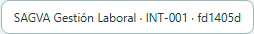

# Evidencias de actualización local — 08-11-2026

[Informe](../../24-VALIDACION-ACTUALIZADOR-LOCAL-20261108.md). SHA instalado fd1405d5d0fb1defaf6cd6d3860998e107a65759. Resultados sin datos personales, bases ni claves. Registros normalizados a LF y rutas privadas sustituidas. Las pruebas de orquestación/identidad usan dobles; git-real.txt usa repositorios temporales reales. La instalación real se acredita aparte en instalacion-real.txt y verificacion.json.

